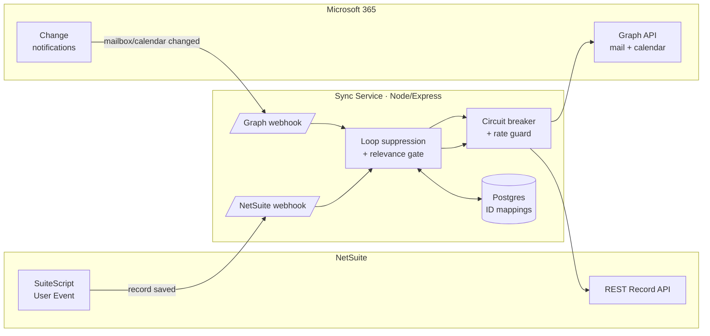

# Case Study: NetSuite ↔ Microsoft 365 Two-Way Sync

Built at Canyon Rim Consulting · Sept–Oct 2026  
**Role:** Sole developer: requirements, architecture, implementation, live testing
**Stack:** Node.js, Express, PostgreSQL / Sequelize, Microsoft Graph (app-only + change notifications), MSAL, NetSuite SuiteScript 2.x, NetSuite REST + OAuth 2.0 M2M, Mocha

> The source code belongs to my former employer and is private. This write-up covers the
> problem, the design, and what I learned, without proprietary code or client details.

---

## The problem

Sales teams working in NetSuite had a split life. An email sent from a NetSuite customer
record never showed up in the rep's Outlook Sent Items, customer replies landed in Outlook
but never made it back to the NetSuite record, and calendars drifted apart. The existing
option was a paid third-party SuiteApp, billed per user.

**Goal:** a NetSuite user's Outlook should look exactly as if they did everything in Outlook,
and NetSuite should keep a complete record of the conversation, **in both directions,
with no per-user setup**.

## Why custom middleware

The first idea was Power Automate. I looked into it and ruled it out: Power Automate can't
sign the JWT that NetSuite's machine-to-machine OAuth requires, so you'd still need a
custom token broker. It also has daily request caps that a sync engine running all day
would hit. A small Node service we controlled was less total code and could become a
product rather than a one-off automation.

## Architecture

- **NetSuite → Outlook.** A SuiteScript User Event fires on save and posts a webhook. The
  service sends mail *as the user* through Graph (draft, then send, so it lands in Sent
  Items), or creates, updates or deletes the matching calendar event.
- **Outlook → NetSuite.** Graph change-notification subscriptions on the mailbox and
  calendar. The service fetches the changed item, runs it through a relevance gate (does
  it belong to a thread NetSuite started, or to a known customer/contact/vendor?), and
  writes it back through NetSuite REST.
- **Auth.** Certificate-based everywhere, with no passwords or client secrets: NetSuite
  OAuth 2.0 client credentials (signed JWT, RSA-4096) and Graph app-only permissions, limited
  to specific mailboxes with an Exchange application access policy.
- **Security baseline from day one.** The service refuses to start if config is missing,
  verifies every inbound webhook, rate-limits ahead of auth, redacts secrets from logs,
  never returns stack traces from internet-facing routes, and has AES-256-GCM encryption
  ready for anything stored.

## The hard part: sync loops

Any two-way sync can talk to itself: write to Outlook → Outlook notifies → write to
NetSuite → NetSuite fires its webhook → write to Outlook… NetSuite makes this harder because
its User Event fires on *every* save from *every* caller (UI, REST, SOAP, workflows,
imports), so blocking known causes one at a time always leaves the next one open.

I ended up with **layered defenses**, because no single one was enough:

1. A context guard in the SuiteScript that ignores the service's own REST writes
2. Content checksums to recognize our own echoes coming back
3. Auto-reply and bounce detection (RFC 3834 headers)
4. A relevance gate so ordinary inbox traffic is never logged
5. A **cause-independent circuit breaker** on outbound email and a rate guard on creates.
   They trip to a halted state, need a manual reset, and send an alert email.

## Incidents I debugged

Five real incidents during live testing. Each got a root cause, a fix, and a write-up.

| Incident | Root cause | Fix |
|---|---|---|
| Outlook → NetSuite **silently dead for two days** while everything showed healthy | Graph subscriptions store their own callback URL. The renewal job extended expiry but never updated the URL after the endpoint moved. | Recreate subscriptions whenever the endpoint changes. Lesson: "not expired" ≠ "working". |
| A test calendar event **drifted months into the future** within minutes | The checksum was computed on local time when writing, but Graph returns UTC on read, so every echo looked like a human edit. The resulting write shifted the time about 5 hours each cycle. | Ask Graph for the matching timezone (`Prefer: outlook.timezone`), normalize precision before hashing. |
| **Email flood** with a NetSuite workflow | A workflow auto-replied to logged messages, and my reliable thread matching made the loop self-sustaining | Auto-reply detection plus the circuit breaker, which stops any future loop whatever its cause |
| Loop guard **silently not matching** | NetSuite's REST API reports a different execution context (`RESTWEBSERVICES`) than the SOAP-era value the guard checked | Confirmed from NetSuite's script execution log, not from docs |
| Calendar **create loop** (one tagged event → six records) | The enum-based guard still didn't match in the deployed script. Proven from execution logs. | String-based context match, a create-rate guard, a duplicate-mapping trip, and Mocha tests for the new paths |

The biggest lesson was about testing. The drift bug hid from every test that checked once,
right away. I changed the test rule to **check twice with a real pause in between**, and to
verify the actual end state with a follow-up API query instead of trusting a `202`.

## Outcome

- **Proven live** end to end with real user actions, not simulated calls. For example, an
  email sent from a NetSuite contact record landed in the rep's own Outlook Sent Items,
  with nothing in the message showing it came from NetSuite. Calendar create, edit, delete
  and cancel were verified both ways.
- **Three loop-free demos** to leadership and engineering. After that the project moved into
  a planned integration with the company's main product platform.
- Documentation written alongside the code: architecture in plain language, a runbook, and
  incident write-ups.

## Phase 2: from prototype to a multi-tenant platform feature (Oct 2026)

After the demos I wrote the **integration plan** for folding the service into the company's
main platform. It went through review with the lead backend developer, and I folded his
amendments into a second revision. I then delivered it as a **planned series of 8 reviewed
pull requests**, each small enough to review on its own:

1. License-gated feature flag, data model, and retention sweep for sync logs
2. Graph client port with **multi-tenant** app-only auth and a **per-mailbox request queue**
3. NetSuite service on the platform's shared client, plus a mailbox resolver
4. Sync handlers, a **durable webhook inbox and worker** ("never send a message twice"), and a **per-tenant circuit breaker** with alerting
5. Graph subscription lifecycle job, and an admin API for setup, mappings, health and the breaker
6. The NetSuite script moved into a proper **SDF project**, so deployments match the repo
7. **Admin UI: mailbox mapping page**, NetSuite employee ↔ Microsoft 365 mailbox
8. **Admin UI: connection setup tab and sync-health card**

The **first live test** in the platform turned up real gaps, and I fixed each with tests:
- A logged reply showed the integration account as sender instead of the real person.
- An unlicensed tenant looked healthy.
- Answering "why didn't this sync?" took a database query.

I added a **"why sync is blocked" banner** that names the exact reason (not licensed, no
Microsoft consent, missing config…), a recent-activity view for admins, visible setup
errors, and the admin-consent return page. I also wrote the **customer onboarding runbook**,
a **Microsoft app setup guide** (multi-tenant app, certificate auth, Exchange RBAC mailbox
scoping), and a **QC test plan** for staging.

## What I'd do differently

- Write tests for the loop-suppression paths **before** the first live test rather than after
  the first incident. I made that a rule halfway through the project.
- Treat subscription health (callback URL + recent deliveries) as something to monitor from
  the start, not just expiry.
- Manage the SuiteScript with NetSuite SDF instead of uploading it by hand from the
  beginning, so the deployed code always matches the repo.

---

*Built with Claude Code as an AI pair programmer. I owned the problem definition,
architecture and trade-off decisions, live testing against NetSuite and Microsoft 365,
incident diagnosis, and every call on what was "proven" vs. "built but unverified."*
