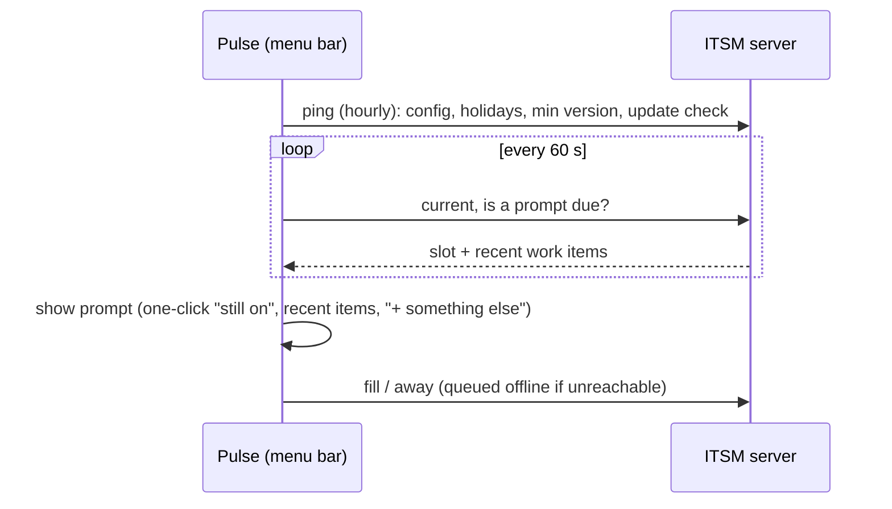

# Case Study: Pulse, a Desktop Time-Capture App

**Pulse Companion** · Built at Canyon Rim Consulting · Sept 2026 · 13 releases (v0.1 → v0.2.3) in two weeks
**Role:** Sole developer: desktop client, release pipeline, server API contract
**Stack:** Tauri 2, Rust (`reqwest`, macOS Keychain, Core Graphics idle APIs), HTML/CSS/JS, GitHub Actions, Ed25519-signed auto-updates

> The source code belongs to my former employer and is private. This write-up covers the
> problem, the design, and what I learned, without proprietary code.

---

## The problem

Our team tracked effort per client in our in-house ITSM platform, but timesheets were
filled in from memory at the end of the day, which is inaccurate and tedious. We were
paying for a third-party app that asks "what are you working on?" at intervals. It didn't
know our clients, tickets or projects, so every answer still had to be re-entered.

**Goal:** replace the paid app with a native companion that asks at the right moments,
offers your actual clients and tickets as one-click answers, and never bills your lunch
break.

## Design

A **menu-bar-only macOS app** (no Dock icon, no main window) acting as a thin client.
**The server owns all scheduling and logic**: intervals, workday hours, holidays, and when a
prompt is due. The app polls, reacts, and reports.

Why that split:
- **Behavior changes ship without releasing a new app.** Interval, workday window and
  holiday rules are server-side config.
- **One source of truth.** The server decides when a slot is due, and the app only tracks
  what it last prompted, so double prompts and clock skew aren't the client's problem.
- **Features degrade gracefully.** New server fields such as holidays and ticket lists are
  optional. Older servers and newer clients keep working.

## Interesting engineering

- **Real idle detection.** The app reads seconds since last input from macOS Core Graphics
  and polls the screen-lock state. Past a configurable threshold it stops prompting and the
  tray shows "away". When you come back, a single catch-up dialog asks what the gap was.
  Sleep and wake are handled by the same logic.
- **Offline-first.** If the server is unreachable, answers queue locally and flush on
  reconnect, and prompts keep firing from cached config.
- **Secure device pairing.** A one-time pairing code from the web app is exchanged for a
  device token stored **only in the macOS Keychain**. Any `401` drops the app back to the
  pairing screen.
- **All HTTP from Rust**, not the webview, so there are no CORS issues and the webview's
  Content Security Policy stays strict. The ticket picker had to be a small vanilla JS combo
  box because a CDN widget library couldn't load under that CSP.
- **Low-friction UX.** The prompt is one click for "still on the same
  thing". It auto-logs "still on" if left untouched while you're active, and there are
  snooze and "I was away" options.

## Release engineering

- **Push a version tag → GitHub Actions builds, signs, publishes** the update to the server
  and attaches the installer to a GitHub Release. No local build machine needed.
- **Ed25519-signed auto-updates.** The app checks hourly, downloads in the background, and
  offers "Restart to update". The signing key never lives in the repo.
- A written **release policy**: a change isn't done until it's released, and versions are
  bumped in both manifests every time.
- 13 tagged releases in the first two weeks.

## Outcome

- In daily use by the Mac-based staff, built as an in-house replacement for a paid per-seat SaaS tool.
- The team liked it enough to start a **Windows port** so the whole company could use it.
- Time entries are captured during the day, tagged to the right client and ticket, instead
  of reconstructed from memory.
- Built the client side of the API contract (ping, current, fill, away, options, update feed)
  and documented every server change the client depends on.

## What I'd do next

- Finish the Windows port (scoped and in progress). The Rust/Tauri split keeps it mostly
  to the platform idle and lock APIs.
- Apple Developer ID signing and notarization, to remove the one-time Gatekeeper warning on
  first install.

---

*Built with Claude Code as an AI pair programmer. I owned the product requirements, the
client/server design, API contract, release process, and testing on real machines.*
